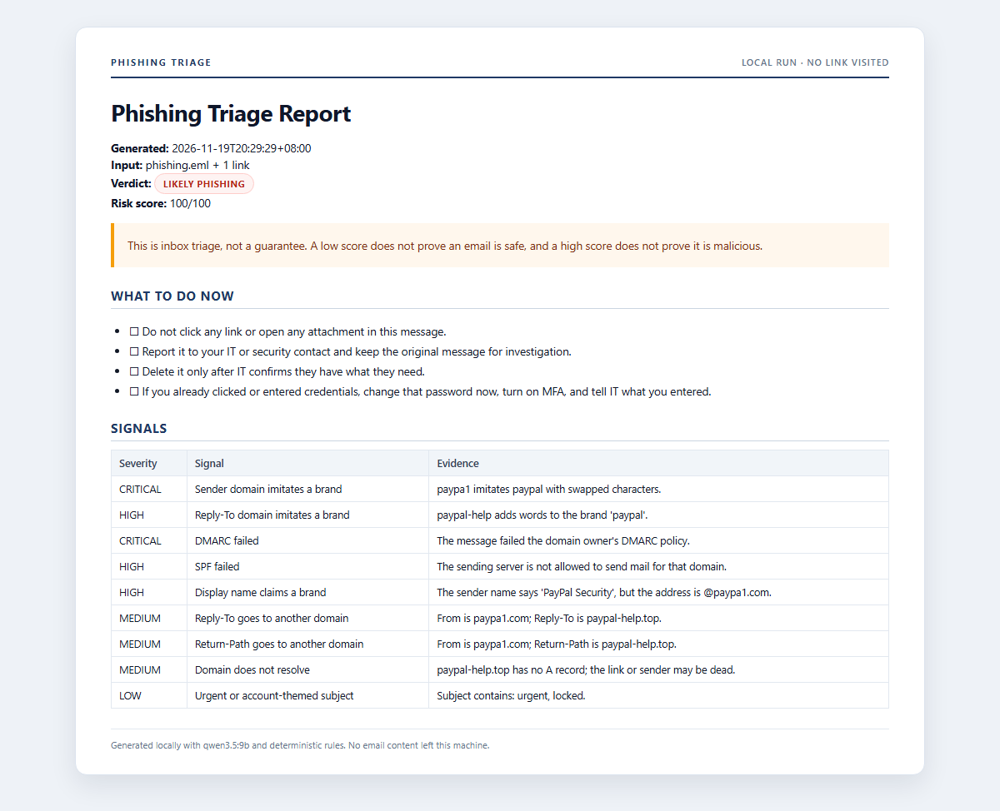
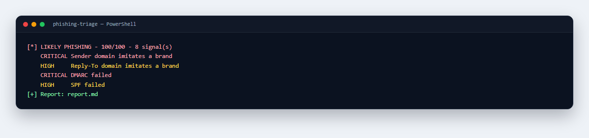
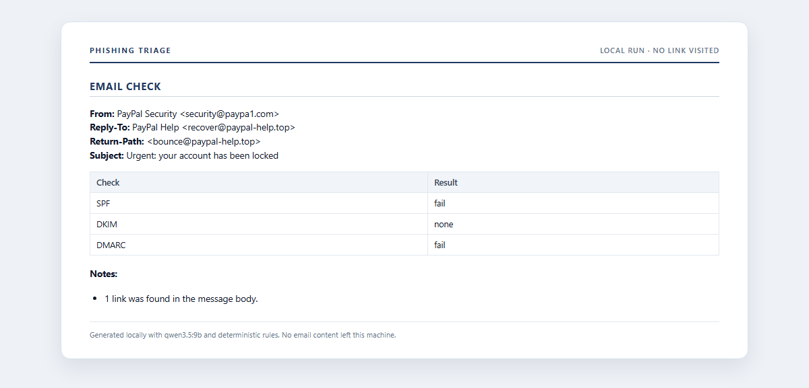
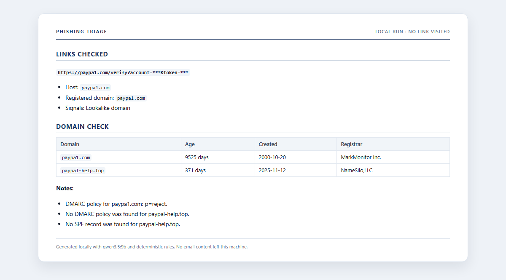
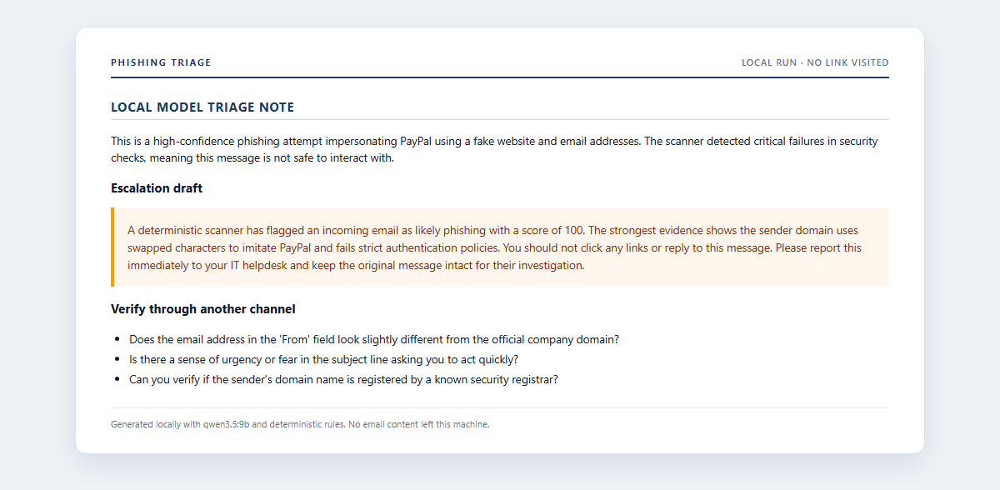

# Phishing & Suspicious Link Triage

[](https://github.com/siolv/phishing-triage/actions/workflows/tests.yml)

Paste a URL or saved email headers. Get a plain-English inbox triage note: what
looks wrong, how worried to be, what to do next, and a message you can send to
IT.

This is **inbox triage**, not email-security research. It does not open the
link, detonate a page, or upload the email. The verdict is deterministic; a
local Ollama model only writes the explanation and escalation draft.

Standard library only. No `pip install`; Ollama is optional.



*Sample run on `samples/phishing.eml`. Full set: [email checks](docs/02-email-checks.png) · [links and domain](docs/03-links-and-domain.png) · [AI escalation](docs/04-ai-escalation.png) · [CLI output](docs/05-cli-output.png).*

## Quick start

```bash
cd phishing-triage

# A single link
python triage.py --url "https://example.com/login"

# A saved email or raw header file
python triage.py --headers samples/phishing.eml

# Offline, no model, no lookups
python triage.py --headers samples/phishing.eml --no-ai --no-lookup
```

Output goes to `report.md`. Add `--json findings.json` for automation.



## What it checks

**The link**
- IP address instead of a domain
- Lookalike brands (`paypa1.com`, `rnicrosoft.com`, swapped characters)
- Brand names hidden in subdomains or before `@`
- Punycode domains, link shorteners, unusual TLDs
- Non-standard ports, long URLs, heavy encoding
- Executables and archives in the path
- `javascript:` and `data:` links

**The sender**
- SPF, DKIM, and DMARC results reported in the headers
- Reply-To and Return-Path pointing somewhere else
- Display name claiming a brand the address does not belong to
- Urgent account or payment language in the subject
- Links found in the message body

**The domain**
- Registration age from public RDAP (new domains are higher risk)
- DMARC policy (`none`, `quarantine`, `reject`)
- SPF record presence
- Whether the domain resolves at all





**The local model**
- A 2-3 sentence summary for a non-technical reader
- A ready-to-send escalation note
- Three verification questions to ask through another channel

The model is told to use only the evidence above, never to say "confirmed", and
never to claim an email is safe.



## Sample result

```text
LIKELY PHISHING - 100/100 - 9 signals
  CRITICAL  Sender domain imitates a brand
  CRITICAL  DMARC failed
  HIGH      Reply-To domain imitates a brand
  HIGH      SPF failed
```

The report also shows the domain age, the auth table, the masked link, and the
steps to take.

## Why the verdict is not written by the model

A local 9B model can be persuasive and wrong. The score comes from explicit
rules with weights; the model receives those signals and turns them into
readable language. If Ollama is offline, the rule-based report still writes.

## CLI

| Flag | What it does |
| --- | --- |
| `--url URL` | Check a link (repeatable) |
| `--headers PATH` | Read a `.eml` or raw header file |
| `--out PATH` | Markdown report path (default `report.md`) |
| `--json PATH` | Machine-readable result |
| `--no-ai` | Skip the local model note |
| `--no-lookup` | Skip RDAP and DNS lookups |
| `--max-links N` | Limit links taken from the email body |
| `--model TAG` | Ollama model (default `qwen3.5:9b`) |
| `--timeout N` | Ollama timeout in seconds |
| `--no-fail` | Always exit 0 |

Exit code is `1` when the score is 70 or higher, so it can gate a mailbox rule
or a pre-send check.

## Privacy and safety

- The suspicious link is **never visited**. URL checks are text-only.
- No email content is uploaded.
- RDAP and Cloudflare DNS-over-HTTPS are queried for public domain data; use
  `--no-lookup` for a fully offline run.
- Reports mask passwords in URLs and redact long query values.
- Raw headers stay on this machine and are not copied into the report.

## Tests

```bash
python -m unittest discover -s tests -v
```

21 tests cover lookalikes, homoglyphs, subdomain tricks, `@` disguises, IP
hosts, shorteners, punycode, `safe_display` redaction, SPF/DKIM/DMARC parsing,
domain age, deduplication, and verdict bands.

## Project layout

```text
phishing-triage/
├── triage.py        # CLI, scoring, report orchestration
├── urls.py          # URL parsing, brand matching, redaction
├── headers.py       # sender and authentication checks
├── intel.py         # RDAP domain age + DNS-over-HTTPS
├── assistant.py     # local Ollama prompt and client
├── report.py        # Markdown report
├── models.py        # shared data structures
├── samples/         # phishing.eml and legit.eml
└── tests/test_triage.py
```

## Limitations

- Links are not opened or detonated, so a page can change after the check.
- Attachments are not opened or analysed.
- SPF/DKIM/DMARC results come from the headers; full DKIM cryptographic
  verification is not performed.
- Domain age is unavailable for some registries.
- Headers can be forged, and the local model can be wrong.
- The brand list is deliberately short; add your own clients and banks to
  `urls.py`.

## Roadmap

- Attachment name and hash checks.
- Batch mode for a folder of `.eml` files.
- A small allowlist for known-good senders.
- Optional screenshot/OCR check for image-only phishing.
- CSV export for a shared inbox review queue.
